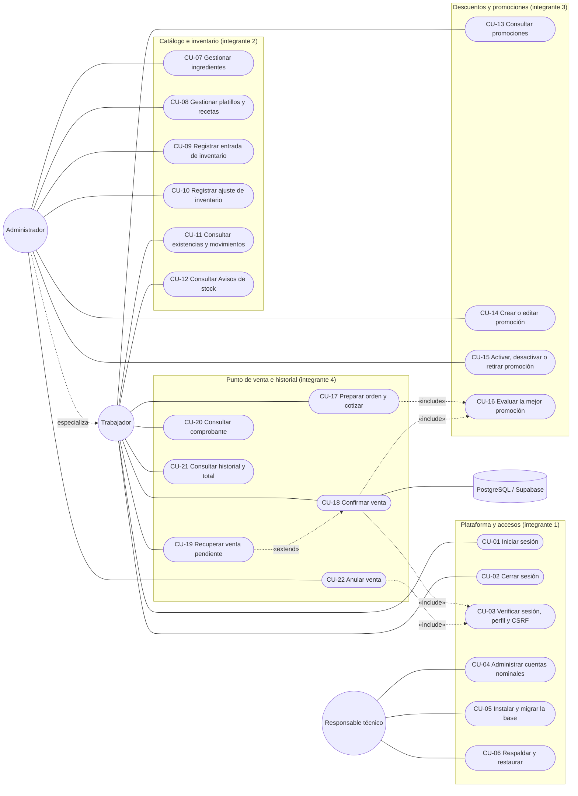

# Casos de uso del MVP web móvil

- Versión: 1.0. Fecha: 27 de octubre de 2026.
- Elaboró: orquestador (Claude Code), por encargo del equipo. Estado: **en revisión documental** por los cuatro integrantes, cada uno en los casos de su módulo.
- Fuentes: [spec.md](../spec.md) versión 2.1, [contratos](contratos/), [matriz de aceptación](matriz-aceptacion.md) y la API implementada en `main` (`6fa4e4d`): rutas de `app/backend/src/routes`, pantallas de `app/frontend` y utilidad `mantenimiento-cuentas`.
- Alcance: solo funciones de la versión 2.1. Lo excluido por la spec no se modela como caso de uso (ver [Fuera de alcance](#fuera-de-alcance)).

Este documento describe el comportamiento esperado y el implementado; no acredita pruebas. La verificación de cada caso corresponde a los criterios CW y al [plan de QA](auditorias/QA-INT-2026-10-19.md).

## Actores

| Actor | Tipo | Descripción |
| --- | --- | --- |
| Trabajador | Principal, humano | Cuenta nominal con perfil fijo TRABAJADOR. Vende, consulta inventario y Avisos, y ve solo sus propias ventas. |
| Administrador | Principal, humano | Cuenta nominal con perfil fijo ADMINISTRADOR. Puede hacer todo lo del Trabajador y además gestiona catálogo, stock, mínimos y promociones, consulta todas las ventas y anula. |
| Responsable técnico | Principal, humano | Persona que opera la utilidad de instalación y mantenimiento desde la terminal del servidor: cuentas, migraciones y respaldos. No usa la web para estas tareas. Corresponde al integrante 1 o a quien él designe. |
| PostgreSQL (Supabase) | Secundario, sistema | Persiste los datos, aplica restricciones y bloqueos y aporta la hora de referencia al confirmar ventas. Solo el backend se conecta. |

El Administrador **especializa** al Trabajador: hereda todos sus casos de uso. No existen otros perfiles ni un editor de roles.

## Diagrama de casos de uso

Para no saturar el diagrama, solo se dibuja la inclusión de CU-03 en dos casos. En realidad, **todas** las operaciones web posteriores al inicio de sesión incluyen CU-03.

## Resumen y trazabilidad

| ID | Caso de uso | Actor principal | Módulo | Tareas W | Criterios CW | Interfaz |
| --- | --- | --- | --- | --- | --- | --- |
| CU-01 | Iniciar sesión | Trabajador | 1 | W1-03 | CW-01 | Login · `POST /auth/login` |
| CU-02 | Cerrar sesión | Trabajador | 1 | W1-03 | CW-01 | Barra de navegación · `POST /auth/logout` |
| CU-03 | Verificar sesión, perfil y CSRF | Sistema (incluido) | 1 | W1-03 | CW-01, CW-02 | Middleware de todas las rutas |
| CU-04 | Administrar cuentas nominales | Responsable técnico | 1 | W1-03, W1-05 | CW-01 | `mantenimiento-cuentas.js` |
| CU-05 | Instalar y migrar la base | Responsable técnico | 1 | W1-02, W1-05 | — | `npm run migrate` |
| CU-06 | Respaldar y restaurar | Responsable técnico | 1 | W1-05, W1-06 | CW-20 | `pg_dump` / `pg_restore` |
| CU-07 | Gestionar ingredientes | Administrador | 2 | W2-02, W2-04, W2-05 | CW-03, CW-08 | Gestión · `/admin/ingredientes` |
| CU-08 | Gestionar platillos y recetas | Administrador | 2 | W2-02, W2-04 | CW-03, CW-14, CW-15 | Gestión · `/admin/platillos` |
| CU-09 | Registrar entrada de inventario | Administrador | 2 | W2-03, W2-04 | CW-04 | Gestión · `/admin/movimientos/entrada` |
| CU-10 | Registrar ajuste de inventario | Administrador | 2 | W2-03, W2-04 | CW-04, CW-16 | Gestión · `/admin/movimientos/ajuste` |
| CU-11 | Consultar existencias y movimientos | Trabajador (existencias), Administrador (movimientos) | 2 | W2-03, W2-04 | CW-04 | `/inventario/existencias`, `/admin/movimientos` |
| CU-12 | Consultar Avisos de stock | Trabajador | 2 | W2-05 | CW-08, CW-09 | Avisos · `/inventario/avisos` |
| CU-13 | Consultar promociones | Trabajador | 3 | W3-02, W3-04 | CW-10 | `GET /promociones` |
| CU-14 | Crear o editar promoción | Administrador | 3 | W3-02, W3-04 | CW-10 a CW-13 | Gestión · `POST`/`PUT /promociones` |
| CU-15 | Activar, desactivar o retirar promoción | Administrador | 3 | W3-02, W3-04 | CW-10 | `PATCH /promociones/:id/estado`, `DELETE /promociones/:id` |
| CU-16 | Evaluar la mejor promoción | Sistema (incluido) | 3 | W3-03, W3-05 | CW-11 a CW-13 | Servicio de cotización |
| CU-17 | Preparar orden y cotizar | Trabajador | 4 | W4-02 | CW-11 a CW-14 | Venta · `POST /promociones/cotizar` |
| CU-18 | Confirmar venta | Trabajador | 4 | W4-03 | CW-05 a CW-07, CW-14, CW-15 | Venta · `POST /ventas/confirmar` |
| CU-19 | Recuperar venta pendiente | Trabajador | 4 | W4-02, W4-03, W4-06 | CW-07, CW-19 | Venta · `GET /ventas/recuperar/:clave` |
| CU-20 | Consultar comprobante | Trabajador | 4 | W4-04 | CW-15 | Venta e Historial · `GET /ventas/:id` |
| CU-21 | Consultar historial y total del periodo | Trabajador | 4 | W4-04 | CW-15, CW-16 | Historial · `GET /ventas/historial` |
| CU-22 | Anular venta | Administrador | 4 | W4-05 | CW-16 | Historial · `POST /ventas/:id/anular` |

Los criterios CW-17 (360 px y navegadores reales) y CW-18 (diseño accesible) aplican a todas las pantallas de los casos anteriores.

## Especificaciones

Convenciones: las rutas de la API cuelgan de `/api/v1`. Entre paréntesis se indica el código de error que devuelve la API. Dinero y cantidades viajan como cadenas decimales.

### Plataforma y accesos

#### CU-01 Iniciar sesión

- **Actor:** Trabajador o Administrador.
- **Objetivo:** obtener una sesión revocable para operar.
- **Precondiciones:** existe una cuenta nominal creada con CU-04; la API alcanza la base.
- **Flujo principal:**
  1. El actor abre la web y escribe correo y contraseña.
  2. El sistema comprueba que la IP y el correo no estén bloqueados por intentos fallidos.
  3. El sistema busca la cuenta y verifica la contraseña con hash seguro. Si la cuenta no existe, también ejecuta una verificación ficticia para que el tiempo de respuesta no lo revele.
  4. El sistema comprueba que la cuenta esté activa.
  5. El sistema crea la sesión, guarda solo el hash del identificador y entrega la cookie `HttpOnly` (`Secure` en HTTPS, `SameSite=Lax`) y el token CSRF.
  6. La web muestra Venta y la navegación según el perfil: Gestión solo para el Administrador.
- **Flujos alternativos:**
  - 1a. Falta el correo o la contraseña → (`DATOS_INVALIDOS`, 400).
  - 2a. Hay un bloqueo vigente → (`DEMASIADOS_INTENTOS`, 429) con `Retry-After`, incluso si la contraseña es correcta.
  - 3a. Credenciales incorrectas → (`CREDENCIALES_INVALIDAS`, 401). Se suma un fallo; a partir del quinto, el bloqueo crece de 30 s hasta un máximo de 15 min.
  - 4a. Cuenta desactivada → (`CUENTA_DESACTIVADA`, 403).
  - 5a. La base no responde → (`ERROR_INTERNO`, 500). Nunca se recurre a cuentas en memoria.
- **Postcondiciones:** sesión vigente durante 8 h; los contadores de fallo de esa IP y ese correo quedan en cero.
- **Reglas:** sin registro público; no se guardan credenciales ni tokens en `localStorage`.

#### CU-02 Cerrar sesión

- **Actor:** Trabajador o Administrador.
- **Precondiciones:** sesión iniciada.
- **Flujo principal:**
  1. El actor elige «Cerrar sesión».
  2. La web envía la petición con el token CSRF.
  3. El sistema revoca la sesión en la base y borra las cookies.
  4. La web limpia el estado del usuario y vuelve al login.
- **Flujos alternativos:** 3a. La revocación falla → la web informa el error y no simula el cierre.
- **Postcondiciones:** reutilizar la cookie anterior devuelve 401. Si había una venta pendiente de verificar, su identidad local se conserva **separada por usuario** y solo reaparece cuando ese mismo usuario vuelve a entrar (CU-19).

#### CU-03 Verificar sesión, perfil y CSRF (incluido)

- **Actor:** sistema; lo incluyen todas las operaciones posteriores al login.
- **Flujo principal:**
  1. El sistema lee la cookie de sesión y valida en la base que exista, no esté revocada ni vencida y que la cuenta siga activa.
  2. Si la operación es de escritura (`POST`, `PUT`, `PATCH`, `DELETE`), comprueba que el origen esté permitido y que la cabecera `X-CSRF-Token` coincida con la cookie.
  3. Si la operación es administrativa, comprueba que el perfil sea ADMINISTRADOR.
  4. Si el caso lo exige, aplica el alcance: el Trabajador solo accede a sus propias ventas.
- **Flujos alternativos:** sin sesión válida → (`NO_AUTENTICADO`, 401); origen externo → (`ORIGEN_NO_PERMITIDO`, 403); token ausente o distinto → (`CSRF_INVALIDO`, 403); perfil insuficiente o venta ajena → (`ACCESO_DENEGADO`, 403).
- **Reglas:** el servidor decide siempre, aunque la web oculte las opciones. Una cuenta desactivada pierde el acceso en la siguiente operación (CW-01, CW-02).

#### CU-04 Administrar cuentas nominales

- **Actor:** Responsable técnico, desde la terminal del servidor.
- **Precondiciones:** base migrada (CU-05) y acceso a la configuración privada del backend.
- **Flujo principal (crear):** el actor ejecuta `crear <nombre> <correo> <contraseña> <ADMINISTRADOR|TRABAJADOR>`; el sistema guarda el correo normalizado, el hash de la contraseña y la cuenta activa.
- **Variantes:**
  - `listar`: muestra las cuentas sin hashes.
  - `desactivar <id>`: en una transacción, bloquea la cuenta y, si es administradora, a los administradores activos. Rechaza la operación si dejaría **cero administradores activos** y revoca todas las sesiones de la cuenta.
  - `activar <id>`: vuelve a habilitar la cuenta.
  - `password <id> <nueva>`: guarda el nuevo hash y revoca las sesiones previas.
- **Flujos alternativos:** perfil inválido o argumentos faltantes → mensaje de uso y código de salida 1; correo repetido → error de la base.
- **Reglas:** no hay pantalla de usuarios ni roles editables. La contraseña viaja como argumento y queda en el historial de la terminal; el responsable debe limpiarlo.

#### CU-05 Instalar y migrar la base

- **Actor:** Responsable técnico.
- **Flujo principal:**
  1. Configura `app/backend/.env` con `DATABASE_URL` y TLS, fuera del repositorio.
  2. Ejecuta `npm run migrate`.
  3. El migrador aplica en orden las migraciones SQL pendientes, cada una de forma atómica, y las registra en `schema_migraciones`.
- **Flujos alternativos:** una migración falla → se revierte esa migración y el proceso termina con código 1; una segunda ejecución sin pendientes no aplica nada.
- **Reglas:** las migraciones aplicadas no se editan; los cambios van en migraciones nuevas. La conexión de la API usa la zona horaria UTC.

#### CU-06 Respaldar y restaurar

- **Actor:** Responsable técnico.
- **Flujo principal:**
  1. Exporta la base de Supabase con `pg_dump` por la conexión recomendada.
  2. Restaura el archivo en una base aislada (`asmibuy_test_*`), nunca sobre datos operativos.
  3. Contrasta cuentas, catálogo, movimientos, promociones, órdenes e importes.
- **Postcondiciones:** existe un respaldo verificado antes del uso operativo (CW-20).
- **Reglas:** el plan Free no ofrece copias administradas descargables y puede pausar el proyecto por inactividad. **Estado:** procedimiento documentado; la restauración real sigue pendiente de evidencia (W1-06).

### Catálogo e inventario

#### CU-07 Gestionar ingredientes

- **Actor:** Administrador (pantalla Gestión).
- **Flujo principal:**
  1. El actor crea un ingrediente con nombre, unidad base (`g`, `ml` o `pieza`) y mínimo no negativo.
  2. El sistema valida la precisión (hasta 3 decimales en g/ml, entero en piezas) y la unicidad del nombre, y lo guarda activo.
  3. Para editarlo, el sistema bloquea el ingrediente y aplica los cambios en una sola transacción.
- **Flujos alternativos:**
  - Nombre repetido o vacío, unidad o mínimo inválidos → (`DATOS_INVALIDOS` o `CANTIDAD_INVALIDA`, 400).
  - Cambiar la unidad con recetas o movimientos existentes → (`UNIDAD_INMUTABLE`).
  - Desactivarlo mientras lo usa un platillo activo → (`INGREDIENTE_EN_USO`), con la lista de platillos que hay que actualizar antes.
  - Ingrediente inexistente → (`RECURSO_NO_ENCONTRADO`, 404).
- **Postcondiciones:** el cambio de mínimo se refleja en Avisos en la siguiente consulta (CU-12).
- **Reglas:** sin conversión automática de unidades; los ingredientes no se borran, se desactivan.

#### CU-08 Gestionar platillos y recetas

- **Actor:** Administrador.
- **Flujo principal:**
  1. El actor crea o edita un platillo con nombre, precio positivo de dos decimales, estado y receta de uno o más ingredientes activos con cantidades positivas.
  2. Al editar, el sistema bloquea el platillo (`FOR UPDATE`), lee sus valores actuales dentro de la misma transacción y actualiza solo los campos recibidos.
  3. El sistema reemplaza la receta y guarda, **sin modificar existencias**.
- **Flujos alternativos:** receta vacía en un platillo activo o ingrediente repetido → (`RECETA_INVALIDA`); ingrediente inactivo → (`INGREDIENTE_INACTIVO`); cantidad con precisión excesiva → (`CANTIDAD_INVALIDA`); nombre repetido → (`DATOS_INVALIDOS`).
- **Postcondiciones:** solo cambian las ventas futuras. Una cotización hecha antes del cambio queda invalidada al confirmar (CU-18, paso 5a).
- **Reglas:** un platillo con receta inválida o ingrediente inactivo no aparece para vender (CW-03).

#### CU-09 Registrar entrada de inventario

- **Actor:** Administrador.
- **Flujo principal:** el actor elige un ingrediente activo, indica una cantidad positiva y un motivo; el sistema registra un movimiento `ENTRADA` con autor y fecha.
- **Flujos alternativos:** cantidad no positiva o con precisión excesiva → (`DATOS_INVALIDOS`); ingrediente inactivo → (`INGREDIENTE_INACTIVO`).
- **Reglas:** la existencia es la suma de los movimientos; un movimiento confirmado no se borra (CW-04). El stock inicial se registra también como entrada.

#### CU-10 Registrar ajuste de inventario

- **Actor:** Administrador.
- **Flujo principal:**
  1. El actor indica ingrediente, cantidad con signo y un motivo obligatorio.
  2. El sistema bloquea el ingrediente, calcula la existencia y comprueba que el saldo resultante no sea negativo.
  3. El sistema registra el movimiento `AJUSTE` con autor y fecha.
- **Flujos alternativos:** motivo vacío o cantidad cero → (`DATOS_INVALIDOS`); saldo negativo → (`STOCK_NEGATIVO_NO_PERMITIDO`).
- **Usos previstos:** merma (ajuste negativo justificado) y recuperación física tras una anulación (ajuste positivo que cita el folio, CW-16).

#### CU-11 Consultar existencias y movimientos

- **Actores:** Trabajador y Administrador consultan existencias, unidad y mínimo; solo el Administrador consulta el historial de movimientos, filtrable por ingrediente.
- **Reglas:** el saldo mostrado coincide con la suma de movimientos y nunca es negativo.

#### CU-12 Consultar Avisos de stock

- **Actor:** Trabajador o Administrador (pantalla Avisos).
- **Flujo principal:**
  1. El actor abre Avisos o vuelve a esa pestaña, recarga la página o termina una operación que altera el stock.
  2. El sistema calcula la condición actual de cada ingrediente: **agotado** con existencia cero (prioritario), **bajo stock** con existencia mayor que cero y menor o igual al mínimo, y **normal** en el resto.
  3. La web muestra **una fila por ingrediente** con existencia, unidad, mínimo y condición, sin depender solo del color.
- **Flujos alternativos:** la consulta falla → la web debe mostrar el error y no presentar datos viejos como vigentes ([arquitectura](arquitectura-tecnica.md)). **Diferencia observada:** hoy la pantalla solo lo registra en la consola y deja la lista anterior; ver [DCU-01](#diferencias-observadas).
- **Reglas:** sin notificaciones push, historial de lectura ni tablas de avisos. Un bajo stock no impide vender si alcanza la cantidad (CW-08, CW-09).

### Descuentos y promociones

#### CU-13 Consultar promociones

- **Actores:** Trabajador y Administrador.
- **Flujo principal:** el sistema lista las promociones con su estado y la vigencia efectiva calculada con la hora del servidor.

#### CU-14 Crear o editar promoción

- **Actor:** Administrador.
- **Flujo principal:**
  1. El actor indica nombre, **un** platillo participante, tipo (`PORCENTAJE` o `NXM`) con sus parámetros y duración (`TEMPORAL` con inicio y fin, o `PERMANENTE` sin fechas).
  2. El sistema valida y guarda: porcentaje mayor que 0 y hasta 100; N y M enteros con N > M ≥ 1; inicio anterior al fin. Las fechas se guardan como instantes UTC y se muestran en la zona del negocio.
- **Flujos alternativos:** porcentaje inválido → (`PORCENTAJE_INVALIDO`); N o M inválidos → (`NXM_INVALIDO`); fechas incoherentes → (`VIGENCIA_INVALIDA` o `DURACION_INVALIDA`); platillo inexistente o inactivo → (`PLATILLO_NO_ENCONTRADO` o `PLATILLO_INACTIVO`); editar una promoción retirada → (`PROMOCION_RETIRADA`, 409); edición concurrente → (`ERROR_CONCURRENCIA`).
- **Postcondiciones:** los cambios solo afectan cotizaciones nuevas. Una cotización previa queda invalidada al confirmar si cambió algún dato de la regla, incluidas las fechas (CU-18, paso 5a).
- **Reglas:** sin monto fijo, mezcla de platillos ni cupones.

#### CU-15 Activar, desactivar o retirar promoción

- **Actor:** Administrador.
- **Flujo principal:** el actor cambia el estado entre `ACTIVA` e `INACTIVA`, o retira la promoción (`RETIRADA`, baja lógica).
- **Flujos alternativos:** estado inválido → (`ESTADO_INVALIDO`); reactivar o editar una retirada → (`PROMOCION_RETIRADA`, 409).
- **Postcondiciones:** desactivar o retirar impide aplicaciones posteriores; las ventas anteriores conservan su copia (CW-10, CW-15).

#### CU-16 Evaluar la mejor promoción (incluido)

- **Actor:** sistema; lo incluyen CU-17 y CU-18.
- **Flujo principal:**
  1. Consolida las cantidades por platillo.
  2. Obtiene las promociones activas de esos platillos y conserva las vigentes con la hora de la base: inicio inclusivo y fin exclusivo; las permanentes no vencen.
  3. Calcula el ahorro de cada una:
     - **Porcentaje:** sobre el subtotal completo de la línea, redondeado a dos decimales con mitad hacia arriba (200 al 15 % → ahorro 30).
     - **NxM:** se cobran `floor(q/N)·M + q mod N` unidades y el resto se bonifica (5×100 en 2x1 → 300; 4×100 en 3x1 → 200).
  4. Elige **una sola** promoción por orden: la de mayor ahorro y, en empate, la de menor identificador.
  5. Aplica el ahorro solo a la línea participante; las demás conservan su precio y las partidas suman el total exacto.
- **Reglas:** cálculo con decimal.js en el servidor; las unidades bonificadas se entregan y consumen igual que las cobradas (CW-11 a CW-13).

### Punto de venta e historial

#### CU-17 Preparar orden y cotizar

- **Actor:** Trabajador o Administrador (pantalla Venta).
- **Precondiciones:** sesión iniciada y ninguna venta pendiente de verificar para ese usuario (si la hay, rige CU-19).
- **Flujo principal:**
  1. La web muestra los platillos vendibles: activos y con receta válida.
  2. El actor agrega platillos y ajusta cantidades enteras positivas. El carrito vive solo en el navegador y no reserva stock.
  3. Ante cada cambio, la web pide la cotización al servidor, que aplica CU-16 y devuelve subtotal, promoción, descuento, total y partidas.
  4. La web muestra el resumen y propone el método de pago: `EFECTIVO` o `EXTERNO`, o `SIN_COBRO` si el total es 0.00.
- **Flujos alternativos:** platillo inactivo o inexistente → (`PLATILLO_INACTIVO` o `PLATILLO_NO_ENCONTRADO`); cantidad inválida → (`CANTIDAD_INVALIDA`); carrito vacío → no se cotiza ni se puede confirmar.
- **Postcondiciones:** la web conserva la cotización aceptable; no hay escrituras en la base.

#### CU-18 Confirmar venta

- **Actor:** Trabajador o Administrador.
- **Precondiciones:** cotización vigente en pantalla; método de pago elegido.
- **Flujo principal:**
  1. El actor confirma el resumen mostrado.
  2. La web genera una **clave idempotente**, guarda la solicitud completa como pendiente separada por usuario y la envía con el token CSRF.
  3. El sistema valida la clave (de 1 a 100 caracteres), el carrito, la correspondencia exacta entre carrito y cotización y el método según el total.
  4. El sistema abre **una transacción** y serializa la clave. Si ya existe una orden con esa clave y la misma solicitud, devuelve la orden original y termina.
  5. Revalida la cotización: bloquea los platillos en orden, lee las promociones y toma la hora de la base **después** de obtener los bloqueos. Después compara precio, receta, promoción, vigencia, partidas y totales con el resumen aceptado (incluye CU-16).
  6. Inserta la orden `CONFIRMADA` con folio y copias históricas: nombres, precios, cantidades cobradas y bonificadas, descuento, regla aplicada y receta.
  7. Bloquea los ingredientes en orden, comprueba la **demanda conjunta** de toda la orden e inserta los consumos, incluidas las unidades gratuitas.
  8. Hace COMMIT y devuelve la orden.
  9. La web borra la solicitud pendiente, muestra el comprobante (CU-20) y prepara una clave nueva.
- **Flujos alternativos:**
  - 3a. Clave inválida o datos incoherentes → (`DATOS_INVALIDOS`, `ORDEN_VACIA`, `DISCREPANCIA_CARRITO_COTIZACION` o `METODO_PAGO_INVALIDO`, 400). Es un rechazo definitivo y la web libera el pendiente.
  - 4a. La clave ya se usó con otra solicitud o por otro usuario → (`IDEMPOTENCIA_CONFLICTO`, 409).
  - 5a. Cambió algún dato económico, la receta o la vigencia → ROLLBACK y (`COTIZACION_DESACTUALIZADA`, 409) con la nueva cotización. La web la muestra y pide aceptarla de nuevo; nunca cobra en silencio un importe distinto (CW-14).
  - 7a. Stock insuficiente para la demanda conjunta → ROLLBACK total y (`STOCK_INSUFICIENTE`, 409), sin escrituras parciales (CW-06).
  - 8a. La respuesta se pierde, hay un error de red o el servidor falla → la web **no** declara éxito, mantiene el pendiente y bloquea otra venta. Continúa en CU-19.
- **Postcondiciones:** orden, partidas y consumos se guardan juntos o no se guarda nada. El stock nunca queda negativo y dos cajas no pueden consumir más de lo disponible (CW-05 a CW-07).

#### CU-19 Recuperar venta pendiente (extiende CU-18)

- **Actor:** el mismo usuario que inició la venta.
- **Punto de extensión:** CU-18, paso 8a, o al volver a Venta, recargar la página o iniciar sesión con una venta pendiente guardada.
- **Flujo principal:**
  1. La web restaura la clave y la solicitud pendientes de ese usuario y bloquea las acciones de venta nueva.
  2. El actor elige «Verificar». El sistema busca la orden por clave y aplica el alcance de CU-03.
  3. Si existe una orden propia, la web muestra su comprobante y libera el pendiente.
- **Flujos alternativos:**
  - 3a. La orden aún no existe → el pendiente se conserva y el actor puede **reintentar** con la misma clave y la misma solicitud exacta, lo que retoma CU-18 desde el paso 3.
  - 3b. La clave pertenece a otro usuario → (`ACCESO_DENEGADO`, 403); la web conserva la identidad para revisión.
  - 3c. Un pendiente de una versión anterior, sin solicitud guardada, solo puede verificarse; si no aparece, requiere revisión del responsable.
- **Reglas:** no habilita ventas sin conexión ni permite descartar el pendiente sin resolverlo (CW-07, CW-19).

#### CU-20 Consultar comprobante

- **Actores:** Trabajador (solo sus ventas) y Administrador (todas).
- **Flujo principal:** el sistema devuelve folio, fecha, cajero, partidas con unidades cobradas y bonificadas, descuento, promoción, total, método de pago y, si aplica, los datos de la anulación.
- **Flujos alternativos:** venta ajena para un Trabajador → (`ACCESO_DENEGADO`, 403); folio inexistente → (`ORDEN_NO_ENCONTRADA`, 404); falla de la base → error, sin datos sustitutos.
- **Reglas:** muestra las copias históricas, no el catálogo actual (CW-15). Sin impresión ni exportación.

#### CU-21 Consultar historial y total del periodo

- **Actores:** Trabajador (sus ventas) y Administrador (todas) (pantalla Historial).
- **Flujo principal:**
  1. El actor elige un rango de fechas, opcional.
  2. El sistema interpreta los días en la zona del negocio (`BUSINESS_TIME_ZONE`), con inicio inclusivo y fin exclusivo al comenzar el día siguiente, según la fecha de confirmación.
  3. Devuelve las órdenes con sus partidas, el conteo de confirmadas y anuladas y el **total de las confirmadas**.
- **Flujos alternativos:** fecha imposible o rango invertido → (`PERIODO_INVALIDO`, 400); falla de la base → error, nunca un periodo vacío simulado.
- **Reglas:** las anuladas se distinguen y quedan fuera del total; no es un cierre fiscal ni de caja (CW-16).

#### CU-22 Anular venta

- **Actor:** Administrador (desde Historial o el comprobante).
- **Flujo principal:**
  1. El actor elige una venta confirmada y escribe un motivo.
  2. El sistema actualiza el estado solo si sigue `CONFIRMADA` y registra motivo, autor y fecha.
  3. La web muestra la venta anulada y el historial la excluye del total.
- **Flujos alternativos:** motivo vacío → (`MOTIVO_REQUERIDO`, 400); perfil Trabajador → (`ACCESO_DENEGADO`, 403); venta ya anulada → devuelve la anulación original sin cambiar el motivo ni el autor (idempotente).
- **Postcondiciones:** el registro original se conserva; **no** se reintegra inventario ni se hace un reembolso bancario. Si hubo recuperación física de insumos, el Administrador la registra con CU-10 citando el folio (CW-16).

## Matriz criterios × casos de uso

| CW | Casos de uso |
| --- | --- |
| CW-01 | CU-01, CU-02, CU-03, CU-04 |
| CW-02 | CU-03 y todos los casos del Administrador |
| CW-03 | CU-07, CU-08, CU-17 |
| CW-04 | CU-09, CU-10, CU-11 |
| CW-05 | CU-18 |
| CW-06 | CU-18 |
| CW-07 | CU-18, CU-19 |
| CW-08 | CU-07, CU-12 |
| CW-09 | CU-12 |
| CW-10 | CU-13, CU-14, CU-15, CU-16 |
| CW-11 | CU-16, CU-17 |
| CW-12 | CU-16, CU-17, CU-18 |
| CW-13 | CU-16 |
| CW-14 | CU-08, CU-14, CU-17, CU-18 |
| CW-15 | CU-18, CU-20, CU-21 |
| CW-16 | CU-10, CU-21, CU-22 |
| CW-17 | Todas las pantallas (CU-01, CU-07 a CU-22) |
| CW-18 | Todas las pantallas |
| CW-19 | CU-18, CU-19 |
| CW-20 | CU-06 |

## Diferencias observadas

Al contrastar los casos con el código de `6fa4e4d`, se registraron estas diferencias. No son hallazgos de auditoría: se entregan al propietario para que decida si corrige el código o este documento.

| ID | Caso | Diferencia | Propietario |
| --- | --- | --- | --- |
| DCU-01 | CU-12 | `avisos.component.ts` (`recargarAvisos`), ante un error de la API, solo escribe en la consola: no muestra ningún mensaje y deja la lista anterior a la vista, como si siguiera vigente. La arquitectura pide «mostrar error si la consulta falla». | Integrante 2 |
| DCU-02 | CU-04 | La utilidad recibe la contraseña como argumento de la línea de comandos, por lo que queda en el historial de la terminal. No incumple la spec, pero conviene pedirla por una entrada oculta. | Integrante 1 |

## Fuera de alcance

No se modelan porque spec.md 2.1 los excluye: registro público, editor de roles o permisos, panel de usuarios, aplicaciones nativas, tiendas, instalación PWA, operación sin conexión, notificaciones push con su historial y preferencias, promociones de monto fijo, mezcla de platillos o cupones, descuento manual, impresión y exportación, informes avanzados, reintegro automático por anulación, devoluciones parciales, varias sucursales, mesas, comandas, reparto, clientes, proveedores, conversión de unidades, facturación, pasarela de pago, crédito, cierre de caja y costeo.

## Revisión

| Módulo | Casos | Revisor documental | Decisión |
| --- | --- | --- | --- |
| 1 Plataforma y accesos | CU-01 a CU-06 | Integrante 1 | Pendiente |
| 2 Catálogo e inventario | CU-07 a CU-12 | Integrante 2 | Pendiente |
| 3 Promociones | CU-13 a CU-16 | Integrante 3 | Pendiente |
| 4 Punto de venta | CU-17 a CU-22 | Integrante 3 (revisor del 4) | Pendiente |

Cada integrante confirma que sus casos describen el comportamiento acordado y avisa si el código difiere. Una diferencia se corrige en el código o en este documento mediante el flujo habitual.
