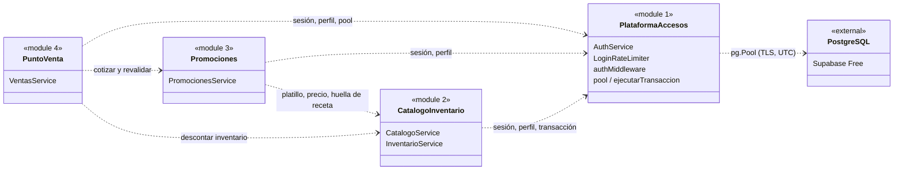
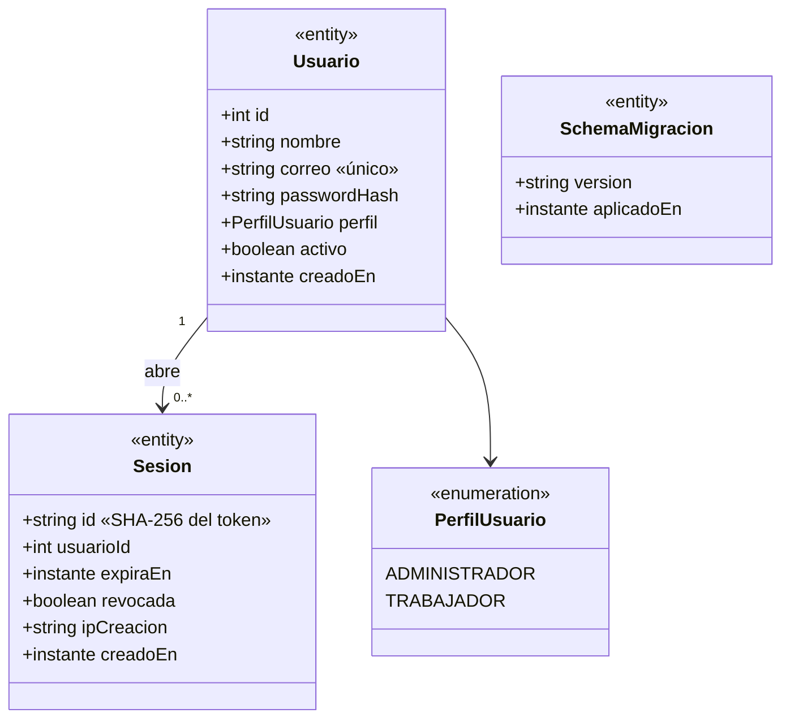
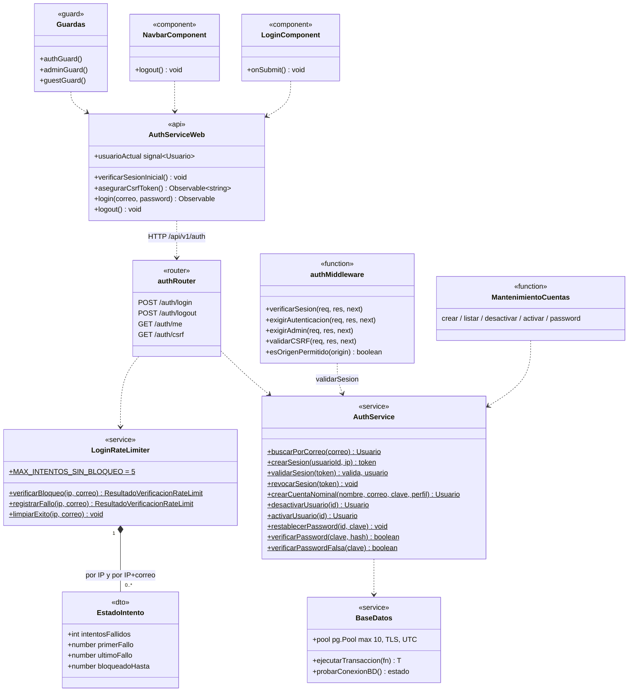
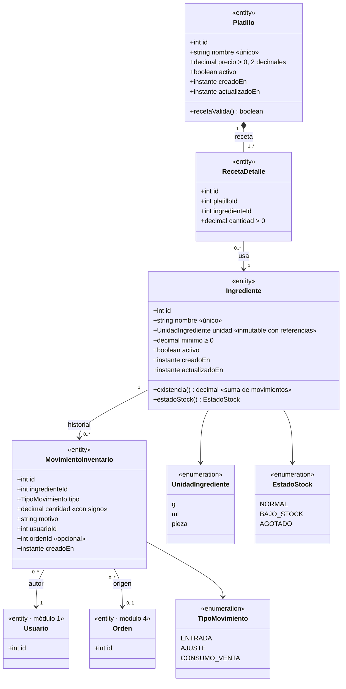
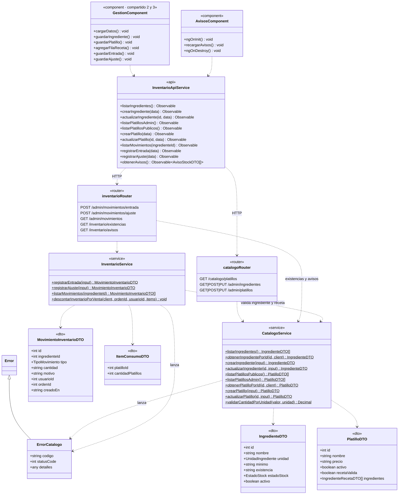
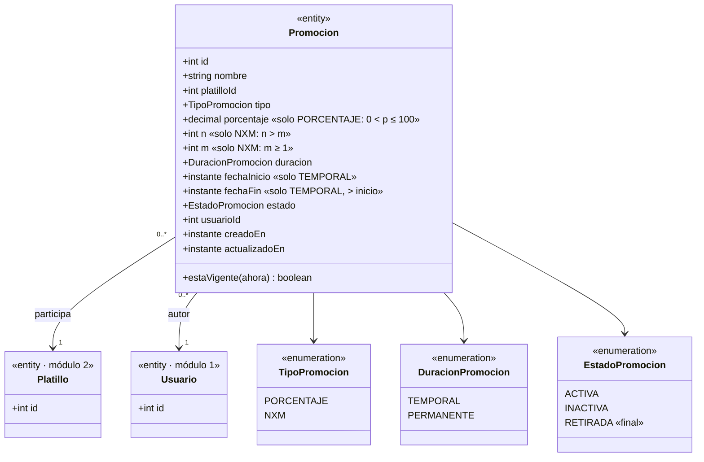
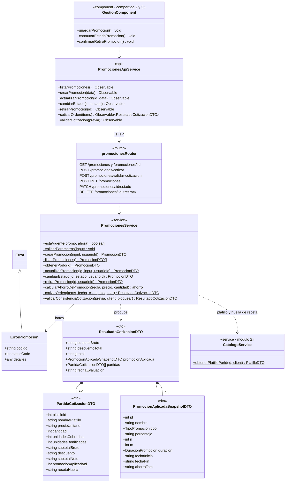
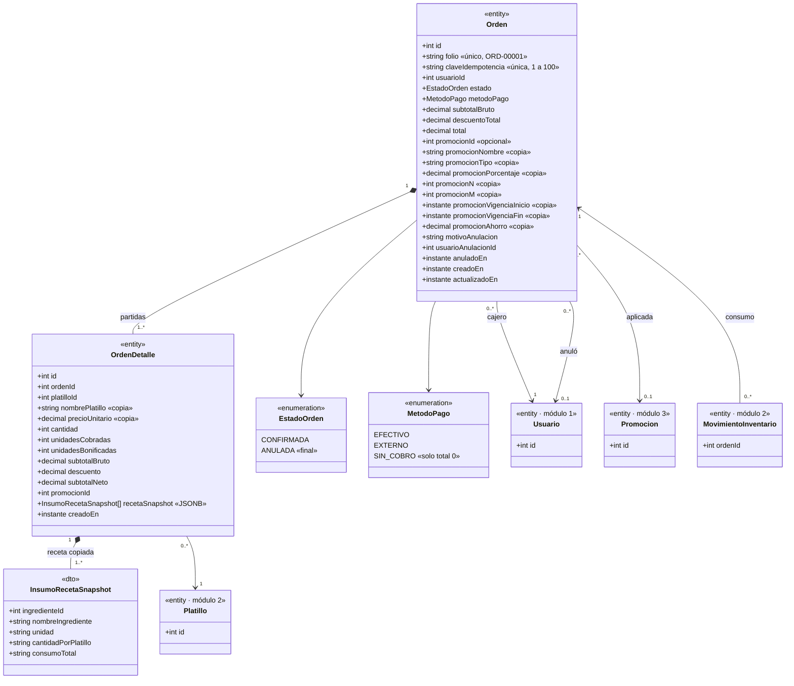
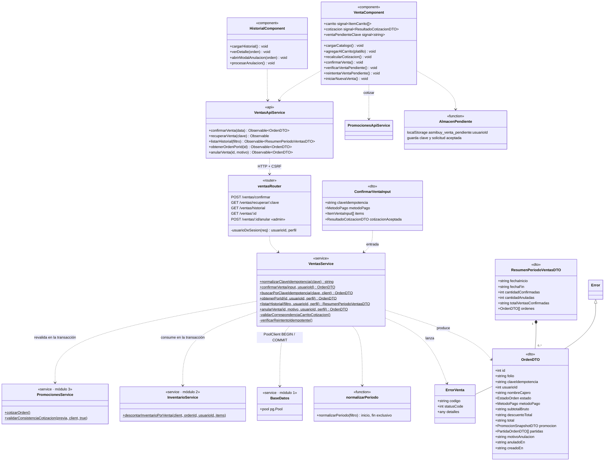

# Diagramas de clase por módulo

- Versión: 1.0. Fecha: 27 de octubre de 2026.
- Elaboró: orquestador (Claude Code), por encargo del equipo. Estado: **en revisión documental** por los cuatro integrantes.
- Fuentes: código de `main` (`fea32d6`): migraciones SQL, servicios y rutas de `app/backend/src`, servicios, guardas y componentes de `app/frontend/src/app`. Complementa los [casos de uso](casos-de-uso.md).

## Cuántos diagramas genera cada módulo

Cada módulo genera **dos diagramas de clase**, y uno adicional muestra cómo se integran. En total, **nueve**.

| Módulo | Integrante | Diagramas | Contenido |
| --- | --- | --- | --- |
| General | Coordinación | 1 · [D0](#d0-integración-entre-módulos) | Dependencias entre los cuatro módulos y la infraestructura común. |
| Plataforma y accesos | 1 | 2 · [D1.1](#d11-modelo-de-dominio) y [D1.2](#d12-diseño-por-capas) | Usuarios y sesiones; autenticación, límite de intentos, CSRF y transacción compartida. |
| Catálogo e inventario | 2 | 2 · [D2.1](#d21-modelo-de-dominio) y [D2.2](#d22-diseño-por-capas) | Ingredientes, platillos, recetas y movimientos; catálogo, inventario y Avisos. |
| Descuentos y promociones | 3 | 2 · [D3.1](#d31-modelo-de-dominio) y [D3.2](#d32-diseño-por-capas) | Promoción y su copia aplicada; administración y motor de cotización. |
| Punto de venta e historial | 4 | 2 · [D4.1](#d41-modelo-de-dominio) y [D4.2](#d42-diseño-por-capas) | Orden, partidas y copias históricas; confirmación, recuperación, historial y anulación. |

- **Modelo de dominio (Dx.1):** entidades persistentes con sus atributos, enumeraciones y asociaciones con multiplicidad, tal como las definen las migraciones. Las entidades de otro módulo aparecen solo con su identificador y la etiqueta del módulo propietario.
- **Diseño por capas (Dx.2):** clases que implementan los casos de uso: componente Angular → servicio API del navegador → router Express → servicio de dominio, con sus DTO, su clase de error y las dependencias hacia otros módulos.

## Convenciones

- Notación UML en Mermaid. Los métodos marcados con `$` son **estáticos**: los servicios del backend no se instancian.
- Estereotipos: `«entity»` (tabla), `«enumeration»`, `«dto»`, `«service»`, `«router»` (`Router` de Express), `«component»` y `«api»` (componente y servicio Angular), `«guard»` y `«function»`.
- Relaciones: `*--` composición, `-->` asociación, `..>` dependencia de uso, `<|--` herencia.
- Tipos: `decimal` es PostgreSQL `numeric`, que viaja como cadena en la API; `instante` es `timestamptz` en UTC.
- Se omiten los métodos privados de mapeo y el almacén en memoria `almacenMemoria`, que solo existe para pruebas sin base de datos.

## D0 Integración entre módulos

La dependencia es en un solo sentido: Ventas consume a Promociones y a Inventario, Promociones consume a Catálogo, y todos usan la plataforma. No hay ciclos entre módulos. La transacción de una venta la abre Ventas y la comparten Promociones e Inventario (ver D4.2).

## Módulo 1 · Plataforma y accesos

### D1.1 Modelo de dominio

Reglas del modelo: el perfil es fijo, sin tabla de roles; siempre queda al menos un administrador activo; la sesión guarda solo el hash del identificador y expira a las 8 h. `Usuario` es referenciado como autor por los otros tres módulos.

### D1.2 Diseño por capas

`authMiddleware` y `BaseDatos` (`config/database.ts` y `db.service.ts`) son infraestructura común: todos los routers pasan por `verificarSesion` y `validarCSRF`, y los servicios transaccionales usan `ejecutarTransaccion` o un `PoolClient` compartido.

## Módulo 2 · Catálogo e inventario

### D2.1 Modelo de dominio

Reglas del modelo: un ingrediente aparece una sola vez por receta; la existencia nunca es negativa; los movimientos confirmados no se borran; un platillo activo necesita al menos un ingrediente activo. `estadoStock` es AGOTADO si la existencia es 0 y BAJO_STOCK si es mayor que 0 y menor o igual al mínimo.

### D2.2 Diseño por capas

`descontarInventarioPorVenta` es el contrato que consume Ventas: recibe el `PoolClient` de la transacción de venta, bloquea los ingredientes en orden ascendente, suma la demanda de toda la orden y lanza `STOCK_INSUFICIENTE` para revertir todo.

## Módulo 3 · Descuentos y promociones

### D3.1 Modelo de dominio

Reglas del modelo: una promoción afecta a un solo platillo; un platillo puede tener varias; `estaVigente` exige estado ACTIVA y, si es temporal, `inicio ≤ ahora < fin`; una promoción RETIRADA no se edita ni se reactiva. Las restricciones `CHECK` de la migración 003 impiden combinaciones inválidas de tipo, parámetros y fechas.

### D3.2 Diseño por capas

`cotizarOrden` y `validarConsistenciaCotizacion` forman el motor que usa Ventas. Con `bloquear = true` y el cliente de la transacción, bloquean los platillos (`FOR UPDATE`) y las promociones (`FOR SHARE`) y toman la hora de la base después de obtener los bloqueos. Si la huella de la regla, la receta, las partidas o los totales difieren de la cotización previa, lanzan `COTIZACION_DESACTUALIZADA`.

## Módulo 4 · Punto de venta e historial

### D4.1 Modelo de dominio

Reglas del modelo: solo se persisten órdenes CONFIRMADAS y ANULADAS; la anulación cambia el estado una sola vez y no borra ni edita partidas; las partidas suman el total; las copias conservan nombre, precio, regla y receta aunque el catálogo cambie después.

### D4.2 Diseño por capas

`confirmarVenta` obtiene un `PoolClient`, abre la transacción y serializa la clave con `pg_advisory_xact_lock`. Después pasa ese mismo cliente a `PromocionesService` (revalidación con bloqueos) y a `InventarioService` (consumo), inserta orden y partidas, y hace COMMIT; el cliente se libera siempre en `finally`. En el navegador, `VentaComponent` guarda la solicitud pendiente por usuario antes de enviarla y solo la libera ante una respuesta definitiva.

## Observaciones de diseño

Surgieron al construir los diagramas. No son hallazgos de auditoría; se entregan a cada propietario para que decida.

| ID | Módulo | Observación |
| --- | --- | --- |
| ODC-01 | 2 y 3 | `GestionComponent` (1 666 líneas) contiene a la vez la gestión de catálogo, inventario y promociones, lo que mezcla la autoría de dos módulos en un solo archivo de `app/frontend`. Separarlo en componentes por módulo haría más clara la propiedad. |
| ODC-02 | 2 | La condición de Avisos se calcula dentro de `inventarioRouter` (`GET /inventario/avisos`) en lugar de en un método de servicio, a diferencia del resto de reglas de negocio. |
| ODC-03 | 4 | `VentasService.confirmarVenta` lee con SQL directo `receta_detalle`, `promociones` y `usuarios` dentro de la transacción para construir las copias históricas. No escribe en esas tablas, pero no pasa por el contrato de sus módulos. Además, `ventas.service.ts` importa `CatalogoService` sin usarlo. |
| ODC-04 | 1 y 2 | Los tipos `UnidadIngrediente`, `TipoMovimiento` y `EstadoStock` se declaran dos veces (`catalogo.service.ts`/`inventario.service.ts` y `almacen-memoria.ts`), y el frontend los vuelve a declarar. Un archivo de tipos compartido evitaría que diverjan. |

## Revisión

| Diagramas | Revisor documental | Decisión |
| --- | --- | --- |
| D0 | Integrante 1 (coordinación de `app/` y `compartido/`) | Pendiente |
| D1.1, D1.2 | Integrante 1 | Pendiente |
| D2.1, D2.2 | Integrante 2 | Pendiente |
| D3.1, D3.2 | Integrante 3 | Pendiente |
| D4.1, D4.2 | Integrante 3 (revisor del 4) | Pendiente |

Si el código cambia, el autor del cambio actualiza el diagrama de su módulo en el mismo commit.
